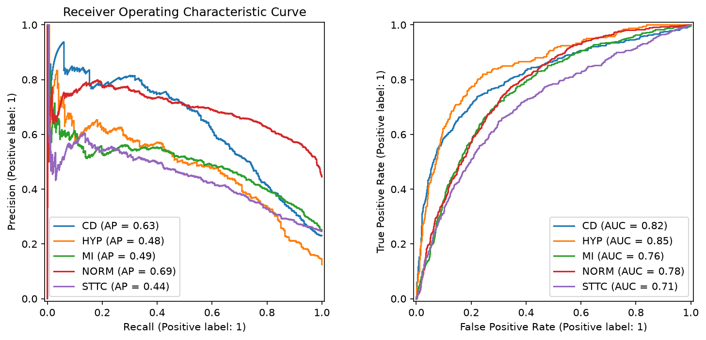

# ECG Classifier

Multi-label classification of 12-lead ECG signals with Python. The project
uses the **PTB-XL 1.0.3** dataset at a sampling rate of 100 Hz and assigns ECG
records to diagnostic superclasses.

## Features

- Load PTB-XL metadata and diagnostic SCP statements
- Map SCP codes to the diagnostic superclasses `CD`, `HYP`, `MI`, `NORM`, and
  `STTC`
- Use the PTB-XL stratified folds for a fixed data split:
  - Training: folds 1-8
  - Validation: fold 9
  - Test: fold 10
- Load and cache 100 Hz ECG signals as NumPy arrays
- Extract simple statistical features per channel: mean, standard deviation,
  maximum, and minimum
- Explore the data and run a baseline model using Jupyter notebooks

## Requirements

- Python 3.12 or newer
- [uv](https://docs.astral.sh/uv/)
- Internet access to download the dataset from PhysioNet

## Installation

Clone the repository and install the dependencies with `uv`:

```bash
git clone https://github.com/jni98/ECG-Classifier.git
cd ECG-Classifier
uv sync
uv run pre-commit install
```

## Download the data

The PTB-XL dataset is not stored in this repository. Download it from the
public PhysioNet S3 mirror using the provided script:

```bash
uv run python scripts/download_data.py
```

The data is saved under `data/raw/`. The script downloads only the 100 Hz
records and excludes the 500 Hz recordings. Make sure sufficient disk space is
available before starting the download.

## Run the notebooks

The project includes the IPython kernel as a development dependency. To launch
JupyterLab without adding it to the project dependencies, use:

```bash
uv run --with jupyterlab jupyter lab
```

Open the notebooks from the project root:

| Notebook | Description |
| --- | --- |
| `01_eda.ipynb` | Exploratory analysis of metadata, diagnoses, and signals |
| `02_baseline.ipynb` | Feature extraction, data splitting, and logistic-regression baseline |

When running `02_baseline.ipynb`, the loaded signals are cached as
`data/processed/X_train.npy`, `data/processed/X_val.npy`, and
`data/processed/X_test.npy`.

## Evaluate the baseline

To train the baseline and evaluate it on validation fold 9 without a notebook,
run from the project root:

```bash
uv run python scripts/evaluate_baseline.py
```

The script trains the logistic-regression baseline on folds 1-8 and prints the
macro AUROC, the AUROC per class, and for each class the threshold that reaches
a sensitivity of at least 90 % together with the resulting specificity and
precision. It also saves the ROC and precision-recall curves to
`reports/figures/roc_pr_curves.png`. Test fold 10 is not used.

## Tests and code quality

```bash
uv run pytest
uv run ruff check .
uv run ruff format --check .
```

The same checks run in GitHub Actions for pushes and pull requests.

## Project structure

```text
.
├── notebooks/
│   ├── 01_eda.ipynb
│   └── 02_baseline.ipynb
├── scripts/
│   ├── download_data.py
│   └── evaluate_baseline.py  # Baseline evaluation on fold 9
├── src/
│   └── ecg/
│       ├── data.py          # Data loading, label mapping, fold splitting
│       ├── evaluate.py      # Metrics, threshold selection, ROC/PR plots
│       └── features.py      # Statistical feature extraction
├── tests/
├── reports/
│   └── figures/
├── pyproject.toml
└── uv.lock
```

The `data/` directory and generated cache files are not tracked by Git.

## Baseline results

The current baseline uses standardized statistical features and a one-vs-rest
logistic regression with class weighting. The following AUROC scores were
**evaluated on validation fold 9**:

| Diagnostic superclass | AUROC |
| --- | ---: |
| `CD` | 0.815 |
| `HYP` | 0.850 |
| `MI` | 0.762 |
| `NORM` | 0.775 |
| `STTC` | 0.710 |
| **Macro average** | **0.783** |


### ROC and precision-recall curves



ROC curves ignore how common a class is, while precision-recall (PR) curves do
not: a random classifier lies on the diagonal in ROC space, but on a horizontal
line at the class prevalence in PR space. That is also where each PR curve
ends at recall 1.0. Prevalences on fold 9: NORM 44.5 %, MI 25.2 %, STTC 24.6 %,
CD 23.1 %, HYP 12.5 %.

| Class | AUROC | AP | Why the PR curve looks different |
| --- | ---: | ---: | --- |
| `CD` | 0.82 | 0.63 | Good ranking plus a medium prevalence gives the second-best AP; precision stays around 0.8 up to a recall of about 0.4 and then drops quickly. |
| `HYP` | 0.85 | 0.48 | Highest AUROC but a low AP: with only 12.5 % HYP cases, even a small false-positive rate creates many false alarms compared to the few true cases. |
| `MI` | 0.76 | 0.49 | Similar prevalence to STTC, so the higher AP reflects the better ranking (higher AUROC), not the class balance. |
| `NORM` | 0.78 | 0.69 | Only mid-field in AUROC but the best AP, because almost half of the ECGs are NORM and false alarms weigh less against many true positives. |
| `STTC` | 0.71 | 0.44 | Lowest AUROC and lowest AP; at similar prevalence to MI and CD, the weaker ranking shows directly in the PR curve. |


## Data source

Wagner, P., Strodthoff, N., Bousseljot, R., Samek, W. & Schaeffter, T.
(2022). *PTB-XL, a large publicly available electrocardiography dataset*
(version 1.0.3). PhysioNet. RRID:SCR_007345.

<https://doi.org/10.13026/kfzx-aw45>

## Roadmap

- [ ] CNN for direct ECG signal processing
- [ ] Experiment tracking with MLflow
- [ ] API deployment with FastAPI
- [ ] Containerization with Docker
